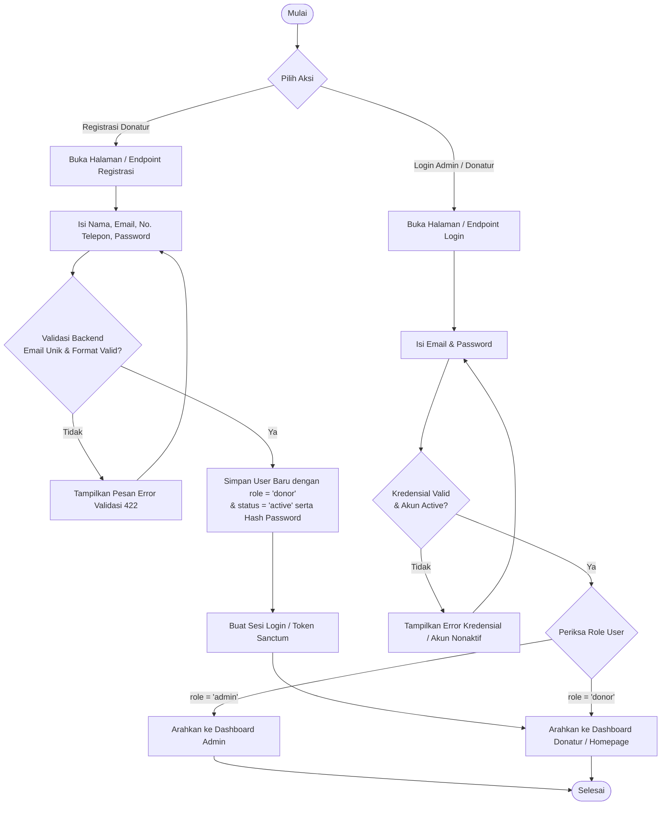
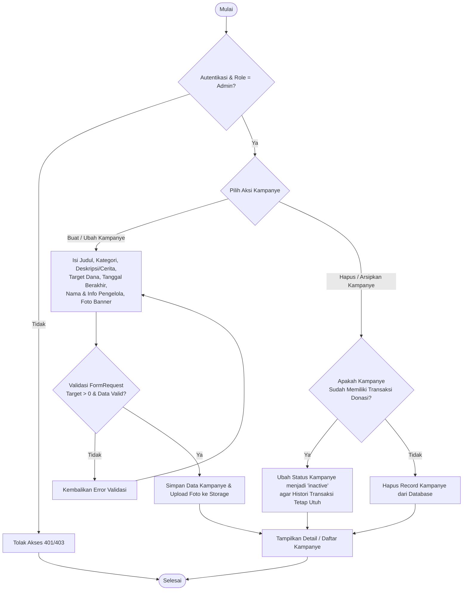
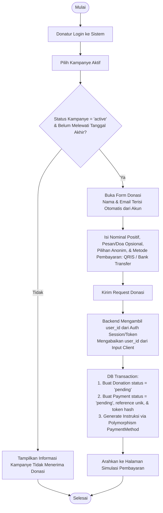
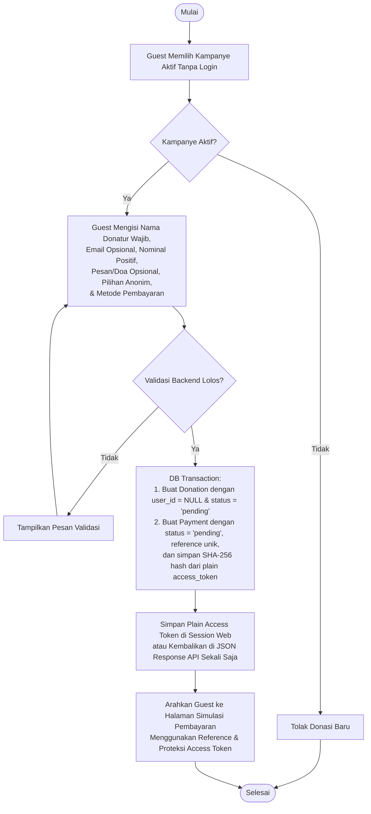
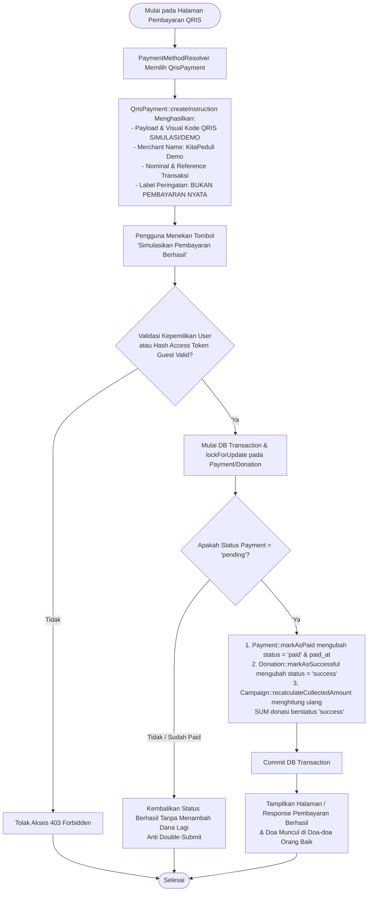
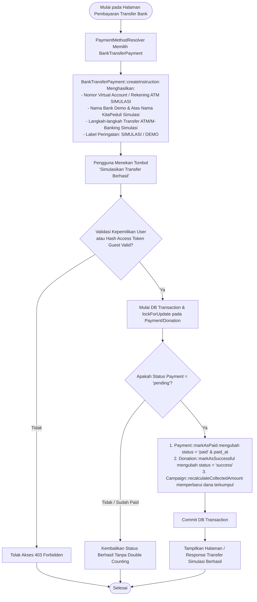
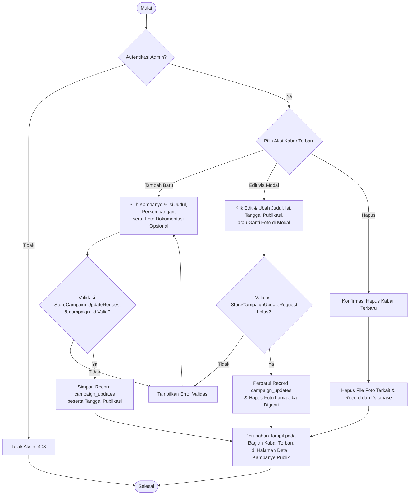
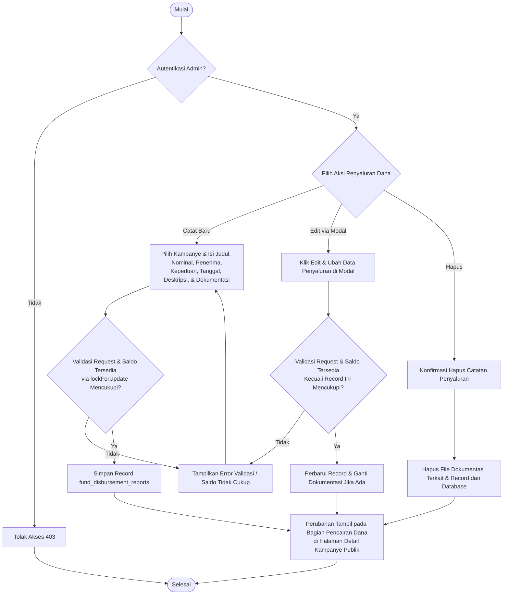

# Activity Diagram: KitaPeduli

Dokumen ini menyajikan **Activity Diagram** untuk proses bisnis utama pada aplikasi **KitaPeduli**.

---

## 1. Activity Diagram: Authentication (Registrasi & Login)

---

## 2. Activity Diagram: Pengelolaan Kampanye (Admin)

---

## 3. Activity Diagram: Donasi Terdaftar (Registered Donor)

---

## 4. Activity Diagram: Guest Donation (Donasi Tanpa Login)

---

## 5. Activity Diagram: Simulasi Pembayaran QRIS

---

## 6. Activity Diagram: Simulasi Pembayaran Transfer Bank

---

## 7. Activity Diagram: Pengelolaan Kabar Terbaru (`CampaignUpdate`)

---

## 8. Activity Diagram: Pengelolaan Laporan Penyaluran Dana (`FundDisbursementReport`)

