# Class Diagram: KitaPeduli

Dokumen ini menyajikan rancangan **Class Diagram** aplikasi **KitaPeduli**, memperlihatkan penerapan empat pilar Pemrograman Berorientasi Objek (**Abstraction, Inheritance, Encapsulation, Polymorphism**) serta prinsip **SOLID** pada lapisan pembayaran, service layer, dan model domain sesuai implementasi final di branch `main`.

> **Catatan Cakupan Diagram:** Lapisan Controller (termasuk 9 controller Admin hasil pemecahan *Single Responsibility Principle* beserta FormRequest dan Middleware) sengaja tidak dimasukkan ke kanvas diagram kelas agar setiap diagram tetap tajam, proporsional, dan terbaca jelas saat diekspor. Pembahasan peran Controller dan pemecahan SRP disajikan secara terpisah pada [`docs/architecture/oop-and-solid-implementation.md`](oop-and-solid-implementation.md).

---

## 1. Diagram 1: Lapisan Pembayaran OOP/SOLID dan Service Layer

Diagram pertama memfokuskan rancangan **abstraksi pembayaran**, **pewarisan polimorfik**, **resolver**, serta **service layer** (`CampaignService`, `DonationService`, `PaymentService`) beserta ketergantungannya terhadap entitas domain.

```mermaid
classDiagram
    %% Contracts / Interfaces
    class PaymentMethodInterface {
        <<interface>>
        +getCode() string
        +getLabel() string
        +createInstruction(Payment payment, Donation donation) array
    }

    class PaymentResolverInterface {
        <<interface>>
        +resolve(string methodCode) PaymentMethodInterface
        +supportedMethods() array
    }

    %% Abstract Payment Class
    class PaymentMethod {
        <<abstract>>
        +string SIMULATION_DISCLAIMER$
        #string code
        #string label
        +getCode() string
        +getLabel() string
        +formatCurrency(float amount) string
        #buildBaseMetadata(Payment payment, Donation donation) array
        +createInstruction(Payment payment, Donation donation) array*
    }

    %% Concrete Payment Classes
    class QrisPayment {
        #string code = "qris"
        #string label = "QRIS (Simulasi Demo)"
        +createInstruction(Payment payment, Donation donation) array
        -generateDemoQrPayload(Payment payment) string
    }

    class BankTransferPayment {
        #string code = "bank_transfer"
        #string label = "Transfer Bank / ATM (Simulasi Demo)"
        +createInstruction(Payment payment, Donation donation) array
        -generateVirtualAccountNumber(Payment payment) string
    }

    %% Resolver / Factory
    class PaymentMethodResolver {
        -array methods
        +__construct(iterable paymentMethods)
        +register(PaymentMethodInterface method) void
        +resolve(string methodCode) PaymentMethodInterface
        +supportedMethods() array
    }

    %% Service Layer
    class CampaignService {
        +createCampaign(array data, User admin, UploadedFile? bannerFile) Campaign
        +updateCampaign(Campaign campaign, array data, UploadedFile? bannerFile) Campaign
        +deleteOrArchiveCampaign(Campaign campaign) array
        -generateUniqueSlug(string title, int? ignoreId) string
    }

    class DonationService {
        -PaymentResolverInterface paymentResolver
        +__construct(PaymentResolverInterface paymentResolver)
        +createDonation(Campaign campaign, array data, User? authenticatedUser) array
        +giveAmen(Donation donation, User user) array
        +removeAmen(Donation donation, User user) array
        +toggleAmen(Donation donation, User user) array
        -generateUniqueReference() string
    }

    class PaymentService {
        -PaymentResolverInterface paymentResolver
        +__construct(PaymentResolverInterface paymentResolver)
        +canAccessPayment(Payment payment, User? user, string? plainToken) bool
        +canSimulatePayment(Payment payment, User? user, string? plainToken) bool
        +getPaymentInstruction(Payment payment) array
        +simulateSuccess(Payment payment) Payment
    }

    %% Referenced Domain Entity Stubs
    class Campaign {
        <<entity>>
    }

    class Donation {
        <<entity>>
    }

    class Payment {
        <<entity>>
    }

    class DonationReaction {
        <<entity>>
    }

    class User {
        <<entity>>
    }

    %% Realization & Generalization
    PaymentMethod ..|> PaymentMethodInterface : implements
    QrisPayment --|> PaymentMethod : extends
    BankTransferPayment --|> PaymentMethod : extends
    PaymentMethodResolver ..|> PaymentResolverInterface : implements

    %% Aggregation & Association (Stored Object References)
    PaymentMethodResolver "1" o-- "0..*" PaymentMethodInterface : manages
    DonationService "1" --> "1" PaymentResolverInterface : uses
    PaymentService "1" --> "1" PaymentResolverInterface : uses

    %% Dependency (Transient Parameter & Method Usage)
    PaymentMethodInterface ..> Payment : reads
    PaymentMethodInterface ..> Donation : reads
    CampaignService ..> Campaign : manages
    CampaignService ..> User : uses admin
    DonationService ..> Campaign : validates
    DonationService ..> Donation : creates
    DonationService ..> Payment : creates
    DonationService ..> DonationReaction : manages
    DonationService ..> User : checks role
    PaymentService ..> Payment : updates state
    PaymentService ..> Donation : updates state
    PaymentService ..> Campaign : recalculates
    PaymentService ..> User : authorizes
```

---

## 2. Diagram 2: Domain Model dan Relasi Entitas

Diagram kedua memetakan delapan **Eloquent Model** pada `app/Models/` secara lengkap beserta konstanta, atribut, visibility (`+`, `-`), modifier (`$`), method domain, method relasi Eloquent, dan kardinalitas antar-tabel.

```mermaid
classDiagram
    class User {
        +string ROLE_ADMIN$
        +string ROLE_DONOR$
        +string STATUS_ACTIVE$
        +string STATUS_INACTIVE$
        +int id
        +string name
        +string email
        +string? phone
        -string password
        +string role
        +string status
        +DateTime? email_verified_at
        +campaigns() HasMany
        +donations() HasMany
        +reactions() HasMany
        +isAdmin() bool
        +isDonor() bool
        +isActive() bool
        +activate() void
        +deactivate() void
    }

    class Category {
        +int id
        +string name
        +string slug
        +string? icon
        +string? description
        +campaigns() HasMany
        +canBeDeleted() bool
    }

    class Campaign {
        +string STATUS_ACTIVE$
        +string STATUS_COMPLETED$
        +string STATUS_INACTIVE$
        +int id
        +int category_id
        +int created_by
        +string title
        +string slug
        +string? short_description
        +string story
        +string? banner_image
        +float target_amount
        +float collected_amount
        +int donor_count
        +Date? start_date
        +Date end_date
        +string organizer_name
        +string? organizer_type
        +string? organizer_description
        +bool is_featured
        +bool is_verified_organizer
        +string status
        +category() BelongsTo
        +creator() BelongsTo
        +donations() HasMany
        +successfulDonations() HasMany
        +updates() HasMany
        +disbursementReports() HasMany
        +scopeActive(Builder query) Builder
        +isAcceptingDonations() bool
        +progressPercentage() int
        +remainingDays() int
        +recalculateCollectedAmount() void
        +changeStatus(string newStatus) void
        +bannerUrl() string
    }

    class Donation {
        +string STATUS_PENDING$
        +string STATUS_SUCCESS$
        +string STATUS_CANCELLED$
        +int id
        +int campaign_id
        +int? user_id
        +string donor_name
        +string? donor_email
        +string? donor_phone
        +float amount
        +string? donor_message
        +bool is_anonymous
        +string status
        +int amen_count
        +campaign() BelongsTo
        +user() BelongsTo
        +payment() HasOne
        +reactions() HasMany
        +scopeSuccessful(Builder query) Builder
        +isGuest() bool
        +isPending() bool
        +isSuccessful() bool
        +publicDonorName() string
        +markAsSuccessful() void
        +markAsCancelled() void
        +refreshAmenCount() void
        +toPublicPrayerArray(int? currentUserId) array
    }

    class Payment {
        +string METHOD_QRIS$
        +string METHOD_BANK_TRANSFER$
        +string STATUS_PENDING$
        +string STATUS_PAID$
        +int id
        +int donation_id
        +string payment_method
        +string reference
        -string access_token_hash
        +float amount
        +string status
        +array? instruction_payload
        +DateTime? paid_at
        +donation() BelongsTo
        +isPending() bool
        +isPaid() bool
        +verifyAccessToken(string? plainToken) bool
        +markAsPaid() void
    }

    class CampaignUpdate {
        +int id
        +int campaign_id
        +int? created_by
        +string title
        +string content
        +string? image_path
        +DateTime published_at
        +campaign() BelongsTo
        +author() BelongsTo
        +imageUrl() string?
    }

    class FundDisbursementReport {
        +int id
        +int campaign_id
        +int? created_by
        +string title
        +float amount
        +string recipient_name
        +string purpose
        +string description
        +string? document_image
        +Date disbursed_at
        +campaign() BelongsTo
        +author() BelongsTo
        +documentUrl() string?
        +availableBalanceForCampaign(int campaignId, int? excludeReportId) float$
        +recordForCampaign(int campaignId, User admin, array data, UploadedFile? documentFile) FundDisbursementReport$
        +updateRecord(FundDisbursementReport report, array data, UploadedFile? documentFile) FundDisbursementReport$
        +deleteRecord(FundDisbursementReport report) void$
    }

    class DonationReaction {
        +int id
        +int donation_id
        +int user_id
        +donation() BelongsTo
        +user() BelongsTo
    }

    %% Model Associations
    User "1" --> "0..*" Campaign : creates
    User "0..1" --> "0..*" Donation : makes
    User "1" --> "0..*" DonationReaction : reacts
    User "0..1" --> "0..*" CampaignUpdate : authors
    User "0..1" --> "0..*" FundDisbursementReport : authors
    Category "1" --> "0..*" Campaign : categorizes
    Campaign "1" --> "0..*" Donation : receives

    %% Model Compositions
    Campaign "1" *-- "0..*" CampaignUpdate : contains
    Campaign "1" *-- "0..*" FundDisbursementReport : contains
    Donation "1" *-- "1" Payment : has
    Donation "1" *-- "0..*" DonationReaction : has

    %% Model Dependency
    FundDisbursementReport ..> Donation : checks balance
```

---

## 3. Penjelasan Hubungan Antar-Kelas dan Notasi UML

### 3.1 Konvensi Simbol UML yang Digunakan
- **Visibility:** `+` (*public*), `#` (*protected*), `-` (*private*). Field sensitif seperti `-password` pada `User` (`$hidden`) dan `-access_token_hash` pada `Payment` (`$hidden`) disimbolkan private untuk menegaskan enkapsulasi.
- **Classifier:** akhiran `*` menandakan method abstrak (`createInstruction()` pada `PaymentMethod`), sedangkan akhiran `$` menandakan konstanta kelas atau method `static` (misalnya `SIMULATION_DISCLAIMER$`, `ROLE_ADMIN$`, `STATUS_ACTIVE$`, `availableBalanceForCampaign()$`, `recordForCampaign()$`, `updateRecord()$`, dan `deleteRecord()$`).

### 3.2 Makna Relasi Antar-Kelas
1. **Generalization / Inheritance (`--|>`):**
   - `QrisPayment` dan `BankTransferPayment` mewarisi (`extends`) kelas abstrak `PaymentMethod`. Keduanya mewarisi `getCode()`, `getLabel()`, `formatCurrency()`, serta `buildBaseMetadata()`, lalu mengimplementasikan `createInstruction()` secara polimorfik.
2. **Realization / Interface Implementation (`..|>`):**
   - `PaymentMethod` mengimplementasikan `PaymentMethodInterface`.
   - `PaymentMethodResolver` mengimplementasikan `PaymentResolverInterface` yang di-bind di `AppServiceProvider`.
3. **Aggregation (`o--`):**
   - `PaymentMethodResolver` menyimpan dan mengelola koleksi objek implementasi `PaymentMethodInterface` (`qris` dan `bank_transfer`) yang dapat tetap hidup secara independen di container aplikasi.
4. **Composition (`*--`):**
   - Satu `Donation` memiliki tepat satu `Payment` (`1:1`) dengan *cascade delete*.
   - Satu `Donation` memiliki banyak `DonationReaction` (`1:0..*`) yang tidak bermakna tanpa donasi induknya.
   - Satu `Campaign` membawahi banyak `CampaignUpdate` dan `FundDisbursementReport` (`1:0..*`) yang terikat pada siklus hidup kampanye.
5. **Association (`-->`):**
   - Digunakan untuk **referensi objek yang disimpan sebagai properti** maupun **relasi permanen antar-model** melalui foreign key:
     - `DonationService` dan `PaymentService` menyimpan properti `-PaymentResolverInterface paymentResolver` hasil *Dependency Injection* pada konstruktornya.
     - `User` berasosiasi dengan `Campaign` (`1` ke `0..*`), `Donation` (`0..1` ke `0..*` karena donasi Guest memiliki `user_id = NULL`), `DonationReaction` (`1` ke `0..*`), serta `CampaignUpdate` dan `FundDisbursementReport` (`0..1` ke `0..*`).
     - `Category` mengategorikan `Campaign` (`1` ke `0..*`), dan `Campaign` menerima `Donation` (`1` ke `0..*`).
6. **Dependency (`..>`):**
   - Digunakan untuk **pemakaian sementara** melalui parameter method, pemanggilan static helper, atau pembuatan/pembaruan state tanpa menyimpan referensi objek sebagai field kelas:
     - `CampaignService` bergantung sementara pada `Campaign` dan `User` (Admin) saat membuat, memperbarui, atau mengarsipkan kampanye (`createCampaign`, `updateCampaign`, `deleteOrArchiveCampaign`).
     - `DonationService` bergantung sementara pada `Campaign`, `Donation`, `Payment`, `DonationReaction`, dan `User` saat membuat transaksi donasi dan mengelola reaksi Aamiin.
     - `PaymentService` bergantung sementara pada `Payment`, `Donation`, `Campaign`, dan `User` saat memeriksa hak akses dan menjalankan `simulateSuccess()`.
     - `PaymentMethodInterface` bergantung sementara pada `Payment` dan `Donation` sebagai parameter `createInstruction()`, dan `FundDisbursementReport` bergantung pada `Donation` untuk menghitung saldo tersedia pada `availableBalanceForCampaign()`.
