# Class Diagram: KitaPeduli

Dokumen ini menyajikan rancangan **Class Diagram** aplikasi **KitaPeduli**, memperlihatkan penerapan empat pilar Pemrograman Berorientasi Objek (**Abstraction, Inheritance, Encapsulation, Polymorphism**) serta prinsip **SOLID** pada model domain, arsitektur pembayaran, dan service layer.

---

## 1. Diagram Kelas Utama (Mermaid)

```mermaid
classDiagram
    %% Contracts / Interfaces
    class PaymentMethodInterface {
        <<interface>>
        +getCode() string
        +getLabel() string
        +createInstruction(Payment payment, Donation donation) array
    }

    class PaymentResolverInterface {
        <<interface>>
        +resolve(string methodCode) PaymentMethodInterface
        +supportedMethods() array
    }

    %% Abstract Payment Class
    class PaymentMethod {
        <<abstract>>
        #string code
        #string label
        +getCode() string
        +getLabel() string
        +formatCurrency(float amount) string
        #buildBaseMetadata(Payment payment, Donation donation) array
        +createInstruction(Payment payment, Donation donation)* array
    }

    %% Concrete Payment Classes
    class QrisPayment {
        #string code = "qris"
        #string label = "QRIS (Simulasi)"
        +createInstruction(Payment payment, Donation donation) array
        -generateDemoQrPayload(Payment payment) string
    }

    class BankTransferPayment {
        #string code = "bank_transfer"
        #string label = "Transfer Bank / ATM (Simulasi)"
        +createInstruction(Payment payment, Donation donation) array
        -generateVirtualAccountNumber(Payment payment) string
    }

    %% Resolver / Factory
    class PaymentMethodResolver {
        -array methods
        +register(PaymentMethodInterface method) void
        +resolve(string methodCode) PaymentMethodInterface
        +supportedMethods() array
    }

    %% Domain Models
    class User {
        +int id
        +string name
        +string email
        +string phone
        -string password
        +string role
        +string status
        +isAdmin() bool
        +isDonor() bool
        +isActive() bool
        +activate() void
        +deactivate() void
        +campaigns() HasMany
        +donations() HasMany
        +reactions() HasMany
    }

    class Category {
        +int id
        +string name
        +string slug
        +string icon
        +string description
        +campaigns() HasMany
        +canBeDeleted() bool
    }

    class Campaign {
        +int id
        +int category_id
        +int created_by
        +string title
        +string slug
        +string short_description
        +string story
        +string banner_image
        +float target_amount
        +float collected_amount
        +int donor_count
        +Date end_date
        +string organizer_name
        +string organizer_type
        +string organizer_description
        +string status
        +isAcceptingDonations() bool
        +progressPercentage() int
        +remainingDays() int
        +recalculateCollectedAmount() void
        +changeStatus(string newStatus) void
        +category() BelongsTo
        +creator() BelongsTo
        +donations() HasMany
        +updates() HasMany
        +disbursementReports() HasMany
    }

    class Donation {
        +int id
        +int campaign_id
        +int? user_id
        +string donor_name
        +string? donor_email
        +float amount
        +string? donor_message
        +bool is_anonymous
        +string status
        +int amen_count
        +isGuest() bool
        +isPending() bool
        +isSuccessful() bool
        +publicDonorName() string
        +markAsSuccessful() void
        +markAsCancelled() void
        +refreshAmenCount() void
        +user() BelongsTo
        +campaign() BelongsTo
        +payment() HasOne
        +reactions() HasMany
    }

    class Payment {
        +int id
        +int donation_id
        +string payment_method
        +string reference
        -string access_token_hash
        +float amount
        +string status
        +array instruction_payload
        +DateTime? paid_at
        +isPending() bool
        +isPaid() bool
        +verifyAccessToken(string plainToken) bool
        +markAsPaid() void
        +donation() BelongsTo
    }

    class CampaignUpdate {
        +int id
        +int campaign_id
        +int? created_by
        +string title
        +string content
        +string? image_path
        +DateTime published_at
        +campaign() BelongsTo
        +author() BelongsTo
    }

    class FundDisbursementReport {
        +int id
        +int campaign_id
        +int? created_by
        +string title
        +float amount
        +string recipient_name
        +string purpose
        +string description
        +string? document_image
        +Date disbursed_at
        +documentUrl() string?
        +availableBalanceForCampaign(int campaignId, int? excludeReportId) float
        +recordForCampaign(int campaignId, int? createdBy, array data) FundDisbursementReport
        +updateRecord(array data) void
        +deleteRecord() void
        +campaign() BelongsTo
        +author() BelongsTo
    }

    class DonationReaction {
        +int id
        +int donation_id
        +int user_id
        +donation() BelongsTo
        +user() BelongsTo
    }

    %% Services
    class DonationService {
        -PaymentResolverInterface paymentResolver
        +createDonation(Campaign campaign, array data, User? user) array
        +giveAmen(Donation donation, User user) array
        +removeAmen(Donation donation, User user) array
        +toggleAmen(Donation donation, User user) array
    }

    class PaymentService {
        -PaymentResolverInterface paymentResolver
        +canAccessPayment(Payment payment, User? user, string? token) bool
        +canSimulatePayment(Payment payment, User? user, string? token) bool
        +getPaymentInstruction(Payment payment) array
        +simulateSuccess(Payment payment) Payment
    }

    class CampaignService {
        +createCampaign(array data, User admin) Campaign
        +updateCampaign(Campaign campaign, array data) Campaign
        +deleteOrArchiveCampaign(Campaign campaign) array
    }

    %% Inheritance & Implementation
    PaymentMethod ..|> PaymentMethodInterface : implements
    QrisPayment --|> PaymentMethod : extends
    BankTransferPayment --|> PaymentMethod : extends
    PaymentMethodResolver ..|> PaymentResolverInterface : implements
    PaymentMethodResolver o-- PaymentMethodInterface : manages

    %% Service Dependencies
    DonationService --> PaymentResolverInterface : depends on
    DonationService --> Donation : creates
    DonationService --> Payment : creates
    PaymentService --> PaymentResolverInterface : depends on
    PaymentService --> Payment : updates state
    PaymentService --> Donation : updates state
    PaymentService --> Campaign : recalculates

    %% Model Relationships
    User "1" --> "0..*" Campaign : creates
    User "0..1" --> "0..*" Donation : makes
    User "1" --> "0..*" DonationReaction : reacts
    Category "1" --> "0..*" Campaign : categorizes
    Campaign "1" --> "0..*" Donation : receives
    Campaign "1" *-- "0..*" CampaignUpdate : contains
    Campaign "1" *-- "0..*" FundDisbursementReport : contains
    Donation "1" *-- "1" Payment : has
    Donation "1" *-- "0..*" DonationReaction : has
```

---

## 2. Penjelasan Hubungan Antar-Kelas

1. **Generalization / Inheritance (`--|>`)**
   - `QrisPayment` dan `BankTransferPayment` mewarisi (`extends`) abstract class `PaymentMethod`. Keduanya menggunakan kembali method umum seperti `getCode()`, `getLabel()`, `formatCurrency()`, dan `buildBaseMetadata()`, serta mengimplementasikan method abstrak `createInstruction()`.
2. **Realization / Interface Implementation (`..|>`)**
   - `PaymentMethod` mengimplementasikan `PaymentMethodInterface`.
   - `PaymentMethodResolver` mengimplementasikan `PaymentResolverInterface` yang di-bind pada Service Container Laravel (`AppServiceProvider`).
3. **Composition (`*--`) & Aggregation (`o--`)**
   - Satu `Donation` memiliki tepat satu `Payment` (`1:1`).
   - Satu `Campaign` memiliki banyak `CampaignUpdate` dan `FundDisbursementReport`.
   - `PaymentMethodResolver` mengelola kumpulan objek implementasi `PaymentMethodInterface` yang terdaftar (`qris` dan `bank_transfer`).
4. **Association (`-->`)**
   - `Donation` berelasi dengan `User` secara opsional (`0..1` ke `0..*`), karena donasi dari Guest memiliki `user_id = NULL`.
   - `Campaign` berelasi dengan `Category` (`N:1`) dan `User` Admin pembuatnya (`N:1`).
5. **Dependency (`-->`)**
   - `DonationService` dan `PaymentService` bergantung pada abstraksi `PaymentResolverInterface` (Dependency Inversion Principle), bukan menginstansiasi `QrisPayment` atau `BankTransferPayment` secara langsung dengan `new` di dalam service.
