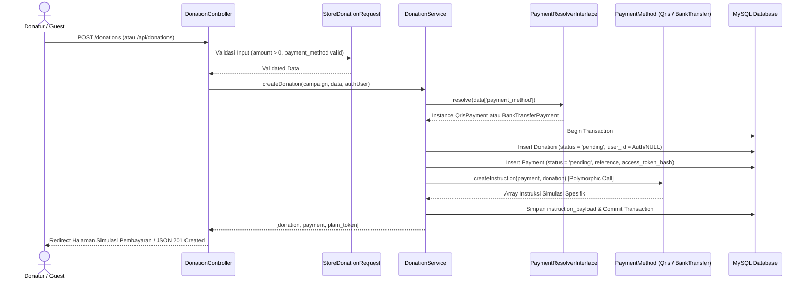

# Implementasi PBO (OOP) dan Prinsip SOLID: KitaPeduli

Dokumen ini menjelaskan secara rinci bukti implementasi nyata **4 Pilar Pemrograman Berorientasi Objek (PBO)** dan **5 Prinsip SOLID** pada kode program aplikasi **KitaPeduli**. Dokumen ini juga berfungsi sebagai panduan presentasi tugas akhir PPBO.

---

## 1. Empat Pilar PBO (Object-Oriented Programming)

### 1.1 Abstraksi (Abstraction)
- **Konsep**: Menyembunyikan detail implementasi teknis dan hanya mengekspos kontrak atau perilaku esensial yang dibutuhkan oleh modul pemanggil.
- **Lokasi File**:
  - `app/Contracts/PaymentMethodInterface.php`
  - `app/Contracts/PaymentResolverInterface.php`
  - `app/Payments/PaymentMethod.php` (Abstract Class)
- **Method Terkait**:
  - `abstract public function createInstruction(Payment $payment, Donation $donation): array;`
  - `public function getCode(): string;`
  - `public function getLabel(): string;`
  - `protected function buildBaseMetadata(Payment $payment, Donation $donation): array;`
- **Penjelasan Implementasi**:
  Class abstrak `PaymentMethod` mendefinisikan kerangka dasar setiap metode pembayaran simulasi di KitaPeduli (memformat mata uang Rupiah, menyusun metadata dasar transaksi, dan mewajibkan adanya label peringatan `"SIMULASI / DEMO: Bukan pembayaran nyata"`), sementara cara pembuatan instruksi spesifik diserahkan kepada class turunan melalui method abstrak `createInstruction()`.

### 1.2 Pewarisan (Inheritance)
- **Konsep**: Class turunan (*subclass*) mewarisi properti dan method dari class induk (*superclass*) sehingga menghindari duplikasi kode dan memperjelas hierarki tipe.
- **Lokasi File**:
  - `app/Payments/QrisPayment.php` (`class QrisPayment extends PaymentMethod`)
  - `app/Payments/BankTransferPayment.php` (`class BankTransferPayment extends PaymentMethod`)
- **Penjelasan Implementasi**:
  Kedua class mewarisi properti `$code`, `$label`, serta method helper `formatCurrency()` dan `buildBaseMetadata()` dari `PaymentMethod`. Selain itu, seluruh model domain (`User`, `Campaign`, `Category`, `Donation`, `Payment`, `CampaignUpdate`, `FundDisbursementReport`, `DonationReaction`) mewarisi `Illuminate\Database\Eloquent\Model`.

### 1.3 Enkapsulasi (Encapsulation)
- **Konsep**: Melindungi state internal objek agar tidak diubah secara sembarangan dari luar class tanpa melalui aturan validasi domain.
- **Lokasi File & Method**:
  1. `app/Models/Payment.php`:
     - `markAsPaid(): void`: Memvalidasi bahwa status saat ini adalah `STATUS_PENDING` sebelum mengubah `status = 'paid'` dan mengisi `paid_at = now()`. Jika sudah `paid`, method melempar `DomainException`.
     - `verifyAccessToken(?string $plainToken): bool`: Mengenkapsulasi verifikasi hash SHA-256 (`hash_equals($this->access_token_hash, hash('sha256', $plainToken))`) sementara atribut `access_token_hash` disembunyikan di `protected $hidden = ['access_token_hash']` agar tidak bocor pada serialisasi JSON API.
  2. `app/Models/Donation.php`:
     - `markAsSuccessful(): void`: Mengubah status donasi menjadi `success` hanya jika status saat ini valid.
     - `publicDonorName(): string`: Mengenkapsulasi aturan privasi donatur: mengembalikan `"Orang Baik (Anonim)"` apabila `is_anonymous === true`, dan mengembalikan `donor_name` asli hanya jika `is_anonymous === false`.
  3. `app/Models/Campaign.php`:
     - `recalculateCollectedAmount(): void`: Mengenkapsulasi perhitungan ulang `collected_amount` dan `donor_count` hanya dari relasi `donations()->where('status', Donation::STATUS_SUCCESS)->where('amount', '>', 0)->whereHas('payment', ...)` (hanya pembayaran `paid`).
     - `isAcceptingDonations(): bool`: Mengenkapsulasi aturan apakah kampanye masih aktif dan belum melewati `end_date`.
  4. `app/Models/FundDisbursementReport.php`:
     - `recordForCampaign()`, `updateRecord()`, dan `deleteRecord()`: Mengenkapsulasi pencatatan penyaluran dana dalam transaksi atomik (`DB::transaction()` + `lockForUpdate()`) dan menolak nominal yang menyebabkan saldo kampanye menjadi negatif.

### 1.4 Polimorfisme (Polymorphism)
- **Konsep**: Kemampuan objek dari berbagai class turunan untuk merespons pemanggilan method yang sama dengan perilaku spesifik masing-masing class.
- **Lokasi File**:
  - `app/Payments/QrisPayment.php` -> `createInstruction(Payment $payment, Donation $donation): array`
  - `app/Payments/BankTransferPayment.php` -> `createInstruction(Payment $payment, Donation $donation): array`
  - Dipanggil secara polimorfik di `app/Services/DonationService.php` dan `app/Services/PaymentService.php`.
- **Contoh Alur Eksekusi**:
  ```php
  // DonationService / PaymentService tidak perlu menggunakan if-else panjang untuk membuat instruksi:
  $gateway = $this->paymentResolver->resolve($payment->payment_method);
  $instruction = $gateway->createInstruction($payment, $donation);
  ```
  - Ketika `$payment->payment_method === 'qris'`, `$gateway` adalah objek `QrisPayment` dan `createInstruction()` menghasilkan payload QRIS simulasi, SVG/kode QR demo, nama merchant `"KitaPeduli Crowdfunding (Simulasi Demo)"`, serta langkah scan QR simulasi.
  - Ketika `$payment->payment_method === 'bank_transfer'`, `$gateway` adalah objek `BankTransferPayment` dan `createInstruction()` menghasilkan nomor Virtual Account simulasi, daftar bank demo, serta langkah transfer ATM/M-Banking simulasi.

---

## 2. Lima Prinsip SOLID

| Prinsip | Nama Lengkap | Implementasi pada KitaPeduli | Lokasi File Bukti |
|---|---|---|---|
| **S** | **Single Responsibility Principle (SRP)** | Pemisahan tanggung jawab secara tegas:<ul><li>Validasi input HTTP ditangani oleh `FormRequest`.</li><li>Controller (`Web` & `Api`) hanya menangani request/response HTTP.</li><li>Panel Admin dipecah menjadi 9 controller per domain (`AdminDashboardController`, `AdminCampaignController`, `AdminCategoryController`, `AdminCampaignUpdateController`, `AdminDisbursementController`, `AdminDonationController`, `AdminUserController`, `AdminReportController`, `AdminProfileController`).</li><li>Logika bisnis pembuatan donasi & reaksi Aamiin berada di `DonationService`.</li><li>Logika bisnis verifikasi akses & simulasi pembayaran berada di `PaymentService`.</li><li>Logika bisnis pengelolaan kampanye & proteksi arsip berada di `CampaignService`.</li></ul> | `app/Http/Requests/*`<br>`app/Http/Controllers/Admin/*`<br>`app/Services/*` |
| **O** | **Open/Closed Principle (OCP)** | Sistem terbuka untuk ekstensi metode pembayaran baru, namun tertutup terhadap modifikasi pada `DonationService` atau `PaymentService`. Jika di masa depan ditambahkan metode baru, cukup buat class turunan `PaymentMethod` baru dan daftarkan di `PaymentMethodResolver` tanpa mengubah alur konfirmasi pembayaran di `PaymentService`. | `app/Payments/PaymentMethod.php`<br>`app/Payments/PaymentMethodResolver.php` |
| **L** | **Liskov Substitution Principle (LSP)** | `QrisPayment` dan `BankTransferPayment` dapat menggantikan tipe induk `PaymentMethod` / `PaymentMethodInterface` di mana pun tipe tersebut digunakan, karena keduanya mengembalikan struktur array instruksi yang mematuhi kontrak yang sama (`method_code`, `method_label`, `is_simulation`, `simulation_notice`, `reference`, `amount`, `steps`, `details`). | `app/Payments/QrisPayment.php`<br>`app/Payments/BankTransferPayment.php` |
| **I** | **Interface Segregation Principle (ISP)** | Kontrak interface dipisah secara spesifik dan ramping sesuai tanggung jawabnya:<ul><li>`PaymentMethodInterface` hanya berisi kontrak untuk satu metode pembayaran (`getCode`, `getLabel`, `createInstruction`).</li><li>`PaymentResolverInterface` hanya berisi kontrak untuk memilih dan mendaftarkan metode pembayaran (`resolve`, `supportedMethods`).</li></ul>Tidak ada "fat interface" yang menggabungkan pembuatan instruksi dengan pencatatan database. | `app/Contracts/PaymentMethodInterface.php`<br>`app/Contracts/PaymentResolverInterface.php` |
| **D** | **Dependency Inversion Principle (DIP)** | Modul tingkat tinggi (`DonationService` dan `PaymentService`) tidak bergantung langsung pada class konkret tingkat rendah (`QrisPayment`, `BankTransferPayment`), melainkan bergantung pada abstraksi `PaymentResolverInterface` dan `PaymentMethodInterface` yang di-inject melalui Constructor Dependency Injection Laravel (`AppServiceProvider`). | `app/Providers/AppServiceProvider.php`<br>`app/Services/DonationService.php`<br>`app/Services/PaymentService.php` |

---

## 3. Diagram Urutan Eksekusi Polimorfisme & DIP (Sequence Diagram)


