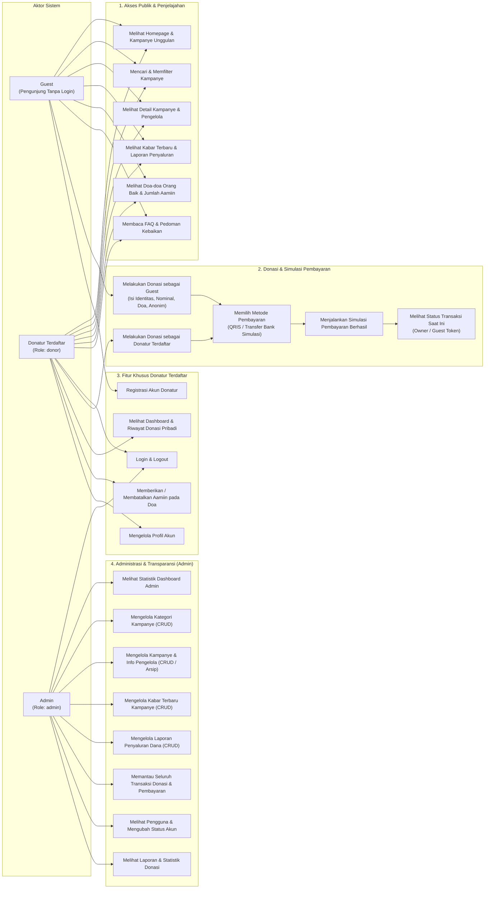

# Use Case Diagram: KitaPeduli

Dokumen ini menjelaskan rancangan **Use Case Diagram** untuk platform crowdfunding dan donasi **KitaPeduli** sesuai ruang lingkup tugas akhir PPBO Laravel 13.

## 1. Definisi Aktor

Sistem **KitaPeduli** memiliki tiga entitas pengguna yang berinteraksi dengan sistem, di mana hanya **dua** yang merupakan role akun pada tabel `users`:

1. **Admin (`role = 'admin'`)**
   - Satu-satunya aktor yang berhak membuat, mengubah, menonaktifkan/mengarsipkan kampanye, mengelola kategori, mempublikasikan kabar terbaru, mencatat laporan penyaluran dana, mengelola status akun pengguna terdaftar, serta memantau seluruh transaksi dan laporan donasi.
   - Admin **tidak** melakukan verifikasi atau persetujuan pembayaran karena sistem menggunakan simulasi pembayaran mandiri.
2. **Donatur Terdaftar (`role = 'donor'`)**
   - Pengguna yang memiliki akun dan telah login.
   - Dapat menjelajahi kampanye, melakukan donasi, menjalankan simulasi pembayaran (QRIS atau Transfer Bank), melihat riwayat dan detail donasi pribadi, mengirim pesan/doa, memilih donasi anonim, memberikan reaksi **Aamiin** pada doa donatur lain, serta mengelola profil akun.
3. **Guest / Donatur Tanpa Login (Bukan Role Akun)**
   - Pengunjung publik yang belum login dan tidak memiliki baris pada tabel `users`.
   - Dapat melihat homepage, mencari dan memfilter kampanye, melihat detail dan transparansi kampanye (kabar terbaru, penyaluran dana, doa-doa orang baik), serta melakukan donasi langsung tanpa registrasi (`donations.user_id = NULL`).
   - Dapat menjalankan simulasi pembayaran dan melihat status transaksi yang sedang dilakukan menggunakan token akses transaksi (`access_token`) yang aman.
   - Tidak memiliki halaman riwayat donasi pribadi dan tidak dapat memberikan reaksi Aamiin.

---

## 2. Diagram Use Case (Mermaid)

---

## 3. Matriks Hak Akses Use Case

| Kode | Nama Use Case | Guest | Donatur Terdaftar | Admin |
|---|---|---:|---:|---:|
| UC-01 | Melihat Homepage, Daftar, dan Detail Kampanye | Ya | Ya | Ya |
| UC-02 | Mencari dan Memfilter Kampanye per Kategori | Ya | Ya | Ya |
| UC-03 | Melihat Transparansi (Kabar Terbaru, Penyaluran, Doa) | Ya | Ya | Ya |
| UC-04 | Registrasi Akun Donatur | Ya | - | Tidak |
| UC-05 | Login dan Logout | - | Ya | Ya |
| UC-06 | Membuat Donasi & Memilih Metode Pembayaran | Ya (`user_id=NULL`) | Ya (`user_id=Auth`) | Tidak |
| UC-07 | Menjalankan Simulasi Pembayaran (QRIS / Bank Transfer) | Ya (Token Transaksi) | Ya (Owner/Token) | Tidak |
| UC-08 | Melihat Status/Hasil Transaksi Saat Ini | Ya (Token Transaksi) | Ya | Ya (Semua) |
| UC-09 | Melihat Riwayat Donasi Pribadi | Tidak | Ya | Tidak Berlaku |
| UC-10 | Memberikan / Membatalkan Aamiin pada Doa Donatur | Tidak | Ya (Maks 1/doa) | Tidak |
| UC-11 | Mengelola Kategori Kampanye | Tidak | Tidak | Ya |
| UC-12 | Membuat, Mengubah, dan Mengarsipkan Kampanye | Tidak | Tidak | Ya |
| UC-13 | Mengelola Kabar Terbaru Kampanye | Tidak | Tidak | Ya |
| UC-14 | Mengelola Laporan Penyaluran Dana | Tidak | Tidak | Ya |
| UC-15 | Memantau Seluruh Transaksi & Laporan Donasi | Tidak | Tidak | Ya |
| UC-16 | Mengelola Status Akun Pengguna Terdaftar | Tidak | Tidak | Ya |
