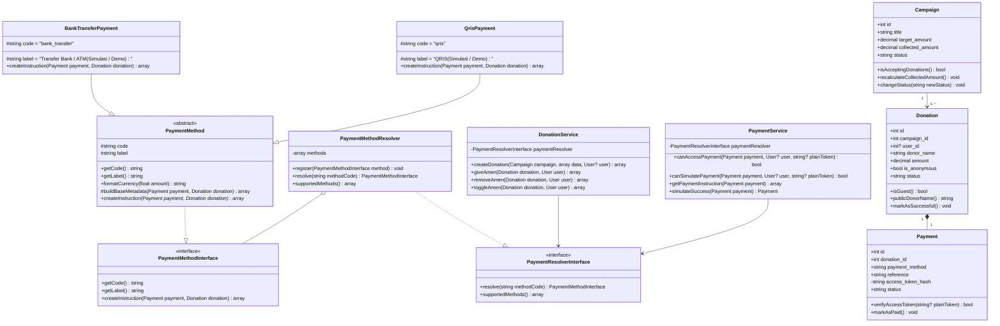

# LAPORAN TUGAS AKHIR PRAKTIKUM PEMROGRAMAN BERORIENTASI OBJEK (PPBO)
## PENGEMBANGAN PLATFORM CROWDFUNDING DAN DONASI SOSIAL KITAPEDULI BERBASIS LARAVEL 13 DAN REST API

---

## COVER

- **Judul Proyek**: KitaPeduli: Sistem Informasi Crowdfunding & Donasi Sosial Berbasis Laravel 13
- **Mata Kuliah**: Praktikum Pemrograman Berorientasi Objek (PPBO) (Pertemuan #14)
- **Dosen Pengampu**: Syahru Rahmayuda, S.Kom., M.Kom
- **Asisten Praktikum**: Andreanus Eko Putra, Dani Ali
- **Identitas Kelompok**:
  1. Muhammad Hafizh Alfitra (`H1101251003`)
  2. Derriel Mulya Ramadhan (`H1101251026`)
  3. Ferdi (`H1101251029`)
  4. Rasya Akmal Sakhi (`H1101251041`)
  5. Raihan Ikram Maulana (`H1101251049`)
  6. Adli Anara Sofian (`H1101251051`)
  7. Chattama Albiantoro (`H1101251069`)
- **Program Studi**: Sistem Informasi, Fakultas Matematika dan Ilmu Pengetahuan Alam, Universitas Tanjungpura
- **Tahun Akademik**: 2026

---

## BAB I PENDAHULUAN

### 1.1 Tujuan Praktikum
1. Mengimplementasikan aplikasi web berbasis kerangka kerja **Laravel 13** dan database relasional **MySQL** untuk studi kasus platform crowdfunding dan donasi sosial bernama **KitaPeduli** (dengan *Kitabisa.com* hanya sebagai platform referensi alur fitur).
2. Menerapkan secara nyata empat pilar utama Pemrograman Berorientasi Objek (**Abstraksi, Inheritance, Encapsulation, dan Polymorphism**) pada arsitektur domain dan modul simulasi pembayaran aplikasi.
3. Menerapkan lima prinsip **SOLID** (*Single Responsibility, Open/Closed, Liskov Substitution, Interface Segregation, dan Dependency Inversion Principle*) agar kode program terstruktur, mudah dipelihara, dan mudah dipresentasikan.
4. Membangun **REST API** berbasis JSON (38 endpoint) yang diamankan menggunakan **Laravel Sanctum** serta mekanisme token transaksi untuk donatur tanpa akun (*Guest Donation*).
5. Mengintegrasikan antarmuka web responsif berbasis **Laravel Blade** dengan lapisan layanan bisnis (*Service Layer*) yang sama dengan REST API.

### 1.2 Dasar Teori

#### A. Pemrograman Berorientasi Objek (PBO / OOP)
Pemrograman Berorientasi Objek adalah paradigma pemrograman yang mengorganisasikan perangkat lunak ke dalam objek-objek yang merepresentasikan entitas dunia nyata beserta atribut dan perilakunya. Empat pilar PBO meliputi:
1. **Abstraksi (*Abstraction*)**: Menyembunyikan detail teknis implementasi dan mendefinisikan kontrak perilaku umum melalui *abstract class* atau *interface*.
2. **Pewarisan (*Inheritance*)**: Mekanisme di mana kelas turunan (*subclass*) mewarisi atribut dan metode dari kelas induk (*superclass*).
3. **Enkapsulasi (*Encapsulation*)**: Pembungkusan data dan logika validasi di dalam kelas untuk melindungi perubahan *state* penting (seperti status pembayaran dan status donasi) agar tidak dimodifikasi secara bebas dari luar.
4. **Polimorfisme (*Polymorphism*)**: Kemampuan objek dari berbagai kelas turunan untuk merespons pemanggilan metode yang sama (seperti `createInstruction()`) dengan hasil dan perilaku yang spesifik sesuai kelasnya.

#### B. Prinsip SOLID
SOLID adalah lima prinsip desain berorientasi objek yang diperkenalkan oleh Robert C. Martin:
- **S (Single Responsibility Principle / SRP)**: Setiap kelas memiliki satu tanggung jawab utama (misalnya *FormRequest* untuk validasi, *Controller* per domain untuk HTTP request/response, dan *Service* untuk proses bisnis).
- **O (Open/Closed Principle / OCP)**: Perangkat lunak terbuka untuk perluasan (*extension*), namun tertutup terhadap modifikasi kode inti (*modification*).
- **L (Liskov Substitution Principle / LSP)**: Kelas turunan harus dapat menggantikan kelas induknya tanpa merusak perilaku sistem.
- **I (Interface Segregation Principle / ISP)**: Kontrak *interface* dirancang spesifik dan fokus sesuai kebutuhan klien.
- **D (Dependency Inversion Principle / DIP)**: Modul tingkat tinggi bergantung pada abstraksi (*interface*), bukan langsung pada kelas konkret tingkat rendah.

#### C. Laravel 13, Eloquent ORM, dan REST API
**Laravel 13** adalah kerangka kerja aplikasi web PHP modern yang menerapkan pola arsitektur MVC (*Model-View-Controller*) dan *Service Container* untuk *Dependency Injection*. **Eloquent ORM** memetakan tabel database MySQL ke dalam objek model PHP, sedangkan **Laravel Sanctum** menyediakan autentikasi berbasis *token* untuk REST API.

---

## BAB II ALAT DAN BAHAN

### 2.1 Perangkat Lunak (*Software*)
Berdasarkan lingkungan pengembangan aktual yang digunakan pada proyek ini:
1. **Sistem Operasi**: Windows (64-bit)
2. **Lingkungan Server Lokal**: Laragon & HeidiSQL
3. **Bahasa Pemrograman**: PHP `8.3.30`
4. **Framework Backend**: Laravel Framework `v13.43.0` (`laravel/laravel v13.0.0`)
5. **Autentikasi API**: Laravel Sanctum `^4.5`
6. **Database**: MySQL Community Server `8.4.3` (Database: `kitapeduli`)
7. **Dependency Manager Backend**: Composer `2.10.3`
8. **Runtime & Build Tool Frontend**: Node.js `v22.22.0`, NPM `10.9.4`, Vite `v7.3.8`, dan Tailwind CSS `v4.0`
9. **Testing Framework**: PHPUnit `12.5.45` & Postman

### 2.2 Perangkat Keras (*Hardware*)
1. **Prosesor**: Prosesor Multi-Core 64-bit (x86_64)
2. **Memori (RAM)**: Minimal 8 GB RAM
3. **Penyimpanan**: SSD dengan ruang kosong minimal 5 GB

---

## BAB III LANGKAH KERJA

### 3.1 Analisis Sistem
**KitaPeduli** dirancang sebagai platform penggalangan dana sosial dengan tiga kelompok pengguna:
1. **Admin (`users.role = 'admin'`)**: Mengelola seluruh siklus hidup kampanye donasi, kategori, informasi pihak pengelola kampanye, kabar terbaru (*campaign updates*), laporan penyaluran dana (*fund disbursement reports*), status akun pengguna terdaftar, serta memantau statistik dashboard dan laporan donasi.
2. **Donatur Terdaftar (`users.role = 'donor'`)**: Pengguna yang melakukan registrasi dan login. Dapat berdonasi, menjalankan simulasi pembayaran, melihat riwayat donasi pribadi, serta memberikan reaksi **Aamiin** pada doa donatur.
3. **Guest / Donatur Tanpa Login**: Pengunjung publik yang belum login dan bukan merupakan role pada tabel `users`. Guest dapat berdonasi langsung (`donations.user_id = NULL`), menjalankan simulasi pembayaran, dan melihat status transaksi saat ini menggunakan token akses transaksi (`access_token`) yang di-hash dengan SHA-256.

### 3.2 Batasan Sistem
1. Hanya **Admin** yang dapat membuat dan mengelola kampanye. Tidak ada role *Fundraiser* dan tidak ada alur pengajuan/persetujuan kampanye oleh pengguna biasa.
2. Pembayaran menggunakan **Simulasi Mandiri** (**QRIS Simulasi** dan **Transfer Bank / ATM Simulasi**). Setiap halaman pembayaran diberi label tegas **"SIMULASI / DEMO: Bukan pembayaran nyata"**. Tidak ada integrasi *payment gateway* finansial nyata, tidak ada unggah bukti transfer, dan tidak ada menu verifikasi pembayaran oleh Admin.
3. Hanya transaksi donasi yang telah berstatus **`success`** (dengan pembayaran **`paid`**) yang dihitung ke dalam total dana terkumpul kampanye dan ditampilkan pada fitur **Doa-doa Orang Baik**.
4. Apabila donatur memilih opsi anonim (`is_anonymous = true`), tampilan publik menampilkan **"Orang Baik (Anonim)"** dan menyembunyikan identitas asli serta email donatur.
5. Kampanye yang telah memiliki histori transaksi donasi tidak dihapus secara permanen (*hard delete*), melainkan diarsipkan (`status = 'inactive'`) agar integritas histori transaksi tetap terjaga.
6. Pencatatan laporan penyaluran dana memeriksa sisa saldo kampanye di dalam transaksi atomik (`DB::transaction()` + `lockForUpdate()`) dan menolak nominal yang menyebabkan saldo kampanye bernilai negatif.

### 3.3 Class Diagram
Berikut adalah **Class Diagram** aplikasi KitaPeduli yang menunjukkan hubungan *Inheritance*, *Interface Implementation*, *Association*, *Composition*, dan *Dependency*:



---

## BAB IV HASIL DAN PEMBAHASAN

### 4.1 Kode Program Inti (Implementasi PBO dan SOLID)

#### A. Abstraksi (`app/Payments/PaymentMethod.php`)
```php
abstract class PaymentMethod implements PaymentMethodInterface
{
    public const SIMULATION_DISCLAIMER = 'SIMULASI / DEMO: Bukan pembayaran nyata';

    protected string $code;
    protected string $label;

    public function getCode(): string
    {
        return $this->code;
    }

    public function getLabel(): string
    {
        return $this->label;
    }

    abstract public function createInstruction(Payment $payment, Donation $donation): array;
}
```

#### B. Inheritance & Polymorphism (`app/Payments/QrisPayment.php` & `BankTransferPayment.php`)
- `QrisPayment extends PaymentMethod` mengimplementasikan `createInstruction()` dengan menghasilkan payload QRIS demo, NMID simulasi, dan langkah simulasi QRIS.
- `BankTransferPayment extends PaymentMethod` mengimplementasikan `createInstruction()` dengan menghasilkan nomor Virtual Account simulasi, kode bank demo, dan langkah simulasi transfer bank.

#### C. Encapsulation (`app/Models/Payment.php` & `app/Models/Donation.php`)
```php
// app/Models/Payment.php
public function markAsPaid(): void
{
    if ($this->status !== self::STATUS_PENDING) {
        throw new DomainException('Transaksi pembayaran ini sudah dikonfirmasi sebelumnya atau tidak berstatus pending.');
    }

    $this->status = self::STATUS_PAID;
    $this->paid_at = now();
    $this->save();
}

// app/Models/Donation.php
public function publicDonorName(): string
{
    return $this->is_anonymous ? 'Orang Baik (Anonim)' : $this->donor_name;
}
```

#### D. Atomic Transaction & Anti Double-Submit (`app/Services/PaymentService.php`)
```php
public function simulateSuccess(Payment $payment): Payment
{
    return DB::transaction(function () use ($payment): Payment {
        $lockedPayment = Payment::where('id', $payment->id)->lockForUpdate()->firstOrFail();
        $lockedDonation = Donation::where('id', $lockedPayment->donation_id)->lockForUpdate()->firstOrFail();

        if (! $lockedPayment->isPending() || ! $lockedDonation->isPending()) {
            throw new DomainException('Transaksi pembayaran ini sudah dikonfirmasi sebelumnya dan tidak dapat diproses ulang.');
        }

        if ((float) $lockedDonation->amount <= 0) {
            throw new DomainException('Nominal donasi harus bernilai positif.');
        }

        $lockedPayment->markAsPaid();
        $lockedDonation->markAsSuccessful();

        $campaign = Campaign::where('id', $lockedDonation->campaign_id)->lockForUpdate()->firstOrFail();
        $campaign->recalculateCollectedAmount();

        return $lockedPayment->fresh(['donation.campaign']);
    });
}
```

#### E. Pemisahan Tanggung Jawab Controller Admin (SRP)
Controller Admin dipisah menjadi 9 kelas terfokus di `app/Http/Controllers/Admin/` tanpa mengubah rute:
`AdminDashboardController`, `AdminCampaignController`, `AdminCategoryController`, `AdminCampaignUpdateController`, `AdminDisbursementController`, `AdminDonationController`, `AdminUserController`, `AdminReportController`, dan `AdminProfileController`.

### 4.2 Hasil Output Antarmuka Web
Aplikasi web **KitaPeduli** memiliki seluruh halaman yang telah terhubung langsung dengan database MySQL `kitapeduli`:
1. **Homepage (`/`)**: Menampilkan navbar responsif, hero kampanye unggulan, bar pencarian cepat, sidebar filter kategori beserta jumlah kampanye aktif, grid 3 kolom kartu kampanye, daftar rekomendasi kampanye, banner CTA, dan footer.
2. **Halaman Jelajahi Kampanye (`/kampanye`)**: Mendukung pencarian kata kunci, filter kategori, pengurutan (*Terbaru, Segera Berakhir, Dana Terbanyak*), dan pagination.
3. **Halaman Detail Kampanye (`/kampanye/{slug}`)**: Menampilkan lengkap 8 komponen transparansi: Cerita Penggalangan Dana, Kabar Terbaru, Pencairan Dana/Laporan Penyaluran, Informasi Pengelola Kampanye, Ringkasan Donasi & Progress Bar, Doa-doa Orang Baik (beserta tombol Aamiin bagi Donatur Terdaftar), Pedoman Kebaikan, dan FAQ.
4. **Halaman Form Donasi (`/kampanye/{slug}/donasi`)**: Dapat diakses oleh Donatur Terdaftar maupun Guest tanpa login.
5. **Halaman Simulasi Pembayaran (`/pembayaran/{reference}`)**: Menampilkan variasi tampilan **QRIS Simulasi** atau **Transfer Bank Simulasi** dengan label peringatan **"SIMULASI / DEMO: Bukan pembayaran nyata"** dan tombol konfirmasi simulasi pembayaran berhasil.
6. **Dashboard & Riwayat Donatur (`/donatur/dashboard`, `/donatur/riwayat-donasi`)**: Menampilkan ringkasan kontribusi dan daftar transaksi pribadi milik Donatur Terdaftar yang sedang login.
7. **Dashboard & Panel Admin (`/admin/dashboard`, dll.)**: Menyediakan pengelolaan Kampanye, Kategori, Kabar Terbaru, Laporan Penyaluran Dana (dengan validasi sisa saldo kampanye), Pemantauan Transaksi Donasi, Manajemen Pengguna, dan Laporan Donasi (tanpa menu verifikasi pembayaran manual).

*(Catatan: Daftar lengkap tangkapan layar yang perlu dimasukkan ke laporan tersedia pada file `docs/report/SCREENSHOT_CHECKLIST.md`.)*

### 4.3 Pengujian REST API & Automated Test
Seluruh **38 endpoint REST API** telah diimplementasikan dan diuji menggunakan **Automated Test PHPUnit (28 Passed, 240 Assertions)** serta didokumentasikan dalam koleksi Postman (`docs/api/KitaPeduli.postman_collection.json`). Rincian hasil pengujian aktual dapat dilihat pada `docs/report/TESTING_RESULTS.md`.

---

## BAB V KESIMPULAN DAN SARAN

### 5.1 Kesimpulan
1. Aplikasi **KitaPeduli** telah berhasil dibangun menggunakan **Laravel 13** dan **MySQL** sesuai dengan batasan ruang lingkup proyek.
2. Empat pilar PBO (**Abstraksi, Inheritance, Encapsulation, dan Polymorphism**) serta prinsip **SOLID** berhasil diterapkan secara nyata pada arsitektur `PaymentMethod`, `QrisPayment`, `BankTransferPayment`, `PaymentMethodResolver`, pemecahan 9 controller Admin SRP, model domain, dan *Service Layer*.
3. Fitur donasi mendukung baik **Donatur Terdaftar** (`user_id` terhubung ke akun) maupun **Guest** (`user_id = NULL`) dengan keamanan token akses transaksi (`X-Transaction-Token` / session) serta pencegahan *double-submit* dan saldo negatif menggunakan transaksi database atomik (`DB::transaction` dan `lockForUpdate`).
4. Seluruh **38 endpoint REST API** dan antarmuka web **Laravel Blade** berbagi logika bisnis yang sama dan telah lulus seluruh skenario pengujian otomatis (**28 passed, 240 assertions**).

### 5.2 Saran
1. Pada pengembangan tahap selanjutnya di luar ruang lingkup akademik saat ini, sistem notifikasi email otomatis dapat diaktifkan ketika simulasi pembayaran berhasil dikonfirmasi.
2. Fitur ekspor laporan donasi ke format PDF atau Excel dapat ditambahkan pada modul laporan Admin untuk memudahkan pelaporan bulanan lembaga.

---

## DAFTAR PUSTAKA

1. Taylor Otwell et al. (2026). *Laravel 13.x Official Documentation*. Diakses dari https://laravel.com/docs/13.x
2. Martin, R. C. (2017). *Clean Architecture: A Craftsman's Guide to Software Structure and Design*. Prentice Hall.
3. Matt Zandstra. (2021). *PHP 8 Objects, Patterns, and Practice: Mastering OO Enhancements, Design Patterns, and Essential Development Tools*. Apress.
4. Modul Praktikum Pemrograman Berorientasi Objek (PPBO) Pertemuan #14: Tugas Akhir Project Cloning Berbasis Laravel.

---

## LAMPIRAN

### Lampiran 1: Link Repository GitHub
- **URL Repository GitHub**: https://github.com/Sakiih/KitaPeduli-Project-Tugas-Akhir-PPBO

### Lampiran 2: Screenshot Repository GitHub
- **Screenshot Halaman Utama Repository GitHub**:
  `[Tempelkan screenshot halaman utama repository GitHub beserta daftar commit di sini]`
- **Screenshot Struktur Folder & Branch di GitHub**:
  `[Tempelkan screenshot struktur folder dan riwayat kontribusi di sini]`
